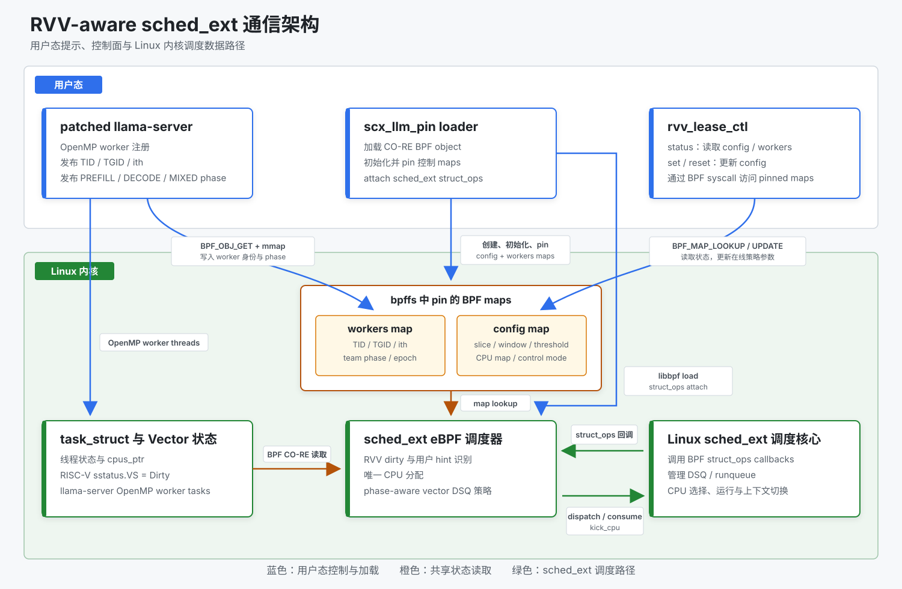
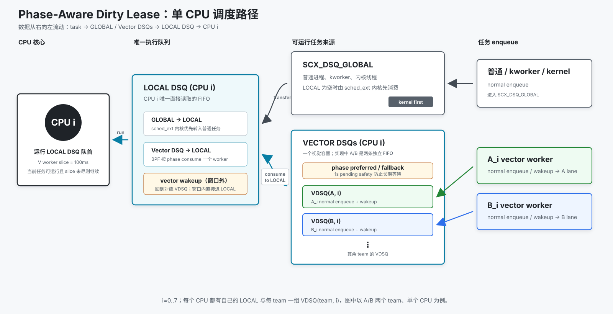

# RISC-V RVV LLM 调度实验平台

本项目面向 Milk-V Jupiter / SpacemiT K1 八核 RISC-V 平台，研究 Linux
`sched_ext` 对 llama.cpp CPU 推理工作负载的调度优化。项目使用 eBPF 调度器识别
执行 RVV 向量计算的 worker，并结合 CPU 分配、vector DSQ、长时间片以及
llama.cpp 提供的 prefill/decode 阶段提示，改善多线程和多模型竞争时的调度行为。

仓库提供一套可复现的实验环境，包括 K1 Linux 6.6 的 sched_ext 补丁、llama.cpp
用户态提示补丁、RVV-aware eBPF 调度器、低开销观测工具和 benchmark。

## 核心能力

- **K1 sched_ext 内核支持**：将 sched_ext 移植到 K1 厂商 Linux 6.6，并补齐厂商树
  的调度器、cgroup、BTF、libbpf 和驱动构建兼容代码。
- **RVV worker 识别**：根据任务的 RISC-V Vector 上下文状态和可配置 dirty 命中
  阈值识别向量计算线程。
- **Phase-aware dirty lease**：为每组 RVV worker 分配互不重复的 CPU，使用
  per-team/per-CPU vector DSQ 和长时间片；普通 wakeup 重新进入 VDSQ，由 phase
  hint 决定 A/B team 的消费顺序，并对 preferred wakeup 提供定向抢占。
- **用户态调度提示**：llama.cpp 可通过 mmapable BPF map 注册 OpenMP worker，
  并发布 `PREFILL`、`DECODE`、`MIXED` 和 `IDLE` 阶段。
- **调度观测**：采集 RVV save/restore 候选、上下文切换、wake-to-run 延迟、
  futex wait/wake 和 blocked time。
- **可重复 benchmark**：支持 CFS、Linux affinity 和 sched_ext 策略对比，以及
  单 llama-server、双 llama-server 异步竞争场景。

## 项目结构

| 目录 | 内容 |
|---|---|
| [`kernel_patches/`](kernel_patches/) | K1 Linux 6.6 sched_ext 移植、厂商树适配和可选 RVV lazy restore |
| [`llama_cpp_patches/`](llama_cpp_patches/) | llama.cpp OpenMP worker 注册和 prefill/decode phase hint |
| [`scx_llm_pin/`](scx_llm_pin/) | RVV-aware sched_ext 调度器、用户态 loader 和控制工具 |
| [`rvv_sched_cost/`](rvv_sched_cost/) | RVV、调度延迟和 futex CO-RE eBPF 观测工具 |
| [`benchmark/`](benchmark/) | workload、预热、采样、结果校验和报告生成脚本 |

## 工作方式

<p align="center">
  <a href="docs/images/architecture.svg">
    
  </a>
</p>

`scx_llm_pin` loader 通过 libbpf 加载 eBPF 程序、初始化并 pin `config/workers`
maps，最后把 struct_ops 附加到 Linux sched_ext。patched llama-server 使用
`BPF_OBJ_GET + mmap` 写入 OpenMP worker 身份和推理 phase；`rvv_lease_ctl` 使用
BPF map lookup/update syscall 读取运行状态或在线调整 slice、vector window、dirty
阈值和 CPU map。

内核调度核心调用 eBPF 的 `select_cpu`、`enqueue`、`dispatch`、`running` 和
`stopping` callbacks。eBPF 调度器结合 BPF maps 与 `task_struct` 中的 RISC-V
Vector 状态完成 RVV worker 识别、CPU 分配和 DSQ 选择，再通过 sched_ext kfunc
把任务交回 Linux 调度核心执行。

### Phase-Aware Dirty Lease

<p align="center">
  <a href="docs/images/phase-aware-lease.svg">
    
  </a>
</p>

Phase-Aware Dirty Lease 是当前完整策略名称。它把 RVV worker 稳定映射到 CPU，
使用 100 ms vector slice 和 per-team/per-CPU VDSQ 保持同组 worker 连续推进，再
根据 llama.cpp 发布的 `PREFILL/MIXED` phase 选择优先运行的 team。

图从左到右展示 CPU、local DSQ、来源 DSQ 和任务；箭头按真实数据流从右向左。
CPU i 最终只从自己的 local DSQ 运行任务。local 为空时，sched_ext 核心先把
global DSQ 的普通任务转入 local；只有 global 没有提供任务时，BPF dispatch 才从
vector DSQ 消费一个 worker 到 local。图中 `VECTOR DSQs (CPU i)` 内的 A/B 是源码
中的两条独立队列 `VDSQ(A,i)` 和 `VDSQ(B,i)`，不是共享 FIFO。

当前推荐配置使用 `--vector-local-wakeup off`：V worker 普通唤醒后返回所属 VDSQ，
重新参与 phase-aware 选择，而不通过旧 local-wakeup fast path 直接进入 local DSQ。
“no-local-wakeup”只描述这一项入队行为，不是策略名称。BPF 优先消费处于
`PREFILL/MIXED` 的 team，首选队列为空时回退到另一 team；preferred worker 唤醒且
同核正在运行另一 team 的 V worker 时可定向抢占。等待达到 1 秒的 runnable
V worker 由 pending safety 兜底，普通任务、helper 和内核任务仍通过 global DSQ
获得服务。

### 实验数据对比

以下正式 campaign 使用两个 llama-server 各 8 个 worker 共享 CPU0-7。四个默认
prompt 文本不同，但均构造为 128 input token；每请求固定输出 256 token。A 侧
incumbent 请求达到 token-4 后，按 1 秒间隔向 B 侧注入等量请求。

c=2/4/8 分别运行 60/30/15 个有效轮次，因此每个策略与并发组合都包含 60 个
injected TTFT 样本。TPS 为跨轮 mean +/- sample SD；TTFT mean、sample SD 和
nearest-rank p95 均直接从 60 个 injected 单请求汇总。

#### c=2

| 策略 | Aggregate TPS (mean +/- SD) | Injected TTFT (mean +/- SD) | Injected TTFT p95 |
|---|---:|---:|---:|
| CFS | 1.6300 +/- 0.0340 | 22.786 +/- 0.291 s | 23.195 s |
| Dirty Lease (`observe`) | 2.5347 +/- 0.0227 (+55.5%) | 15.956 +/- 0.483 s (-30.0%) | 16.747 s (-27.8%) |
| Phase-Aware Dirty Lease | 2.5250 +/- 0.0168 (+54.9%) | 13.904 +/- 0.181 s (-39.0%) | 14.253 s (-38.6%) |

#### c=4

| 策略 | Aggregate TPS (mean +/- SD) | Injected TTFT (mean +/- SD) | Injected TTFT p95 |
|---|---:|---:|---:|
| CFS | 2.0701 +/- 0.0244 | 36.513 +/- 12.556 s | 49.724 s |
| Dirty Lease (`observe`) | 2.6995 +/- 0.0176 (+30.4%) | 26.975 +/- 9.353 s (-26.1%) | 37.767 s (-24.0%) |
| Phase-Aware Dirty Lease | 2.7056 +/- 0.0122 (+30.7%) | 21.173 +/- 7.076 s (-42.0%) | 28.677 s (-42.3%) |

#### c=8

| 策略 | Aggregate TPS (mean +/- SD) | Injected TTFT (mean +/- SD) | Injected TTFT p95 |
|---|---:|---:|---:|
| CFS | 3.2008 +/- 0.0288 | 76.130 +/- 30.395 s | 96.264 s |
| Dirty Lease (`observe`) | 4.0109 +/- 0.0195 (+25.3%) | 50.988 +/- 20.191 s (-33.0%) | 65.434 s (-32.0%) |
| Phase-Aware Dirty Lease | 4.0210 +/- 0.0080 (+25.6%) | 43.983 +/- 17.556 s (-42.2%) | 55.395 s (-42.5%) |

`observe` 读取并校验 worker/phase hint，但不根据 phase 改变调度；完整策略通过
`prefill-lease` 选择 preferred team，并允许满足条件的 preferred wakeup 定向抢占。
Phase-Aware Dirty Lease 相对 CFS 在 c=2/4/8 下分别提升 TPS 约 54.9%、30.7% 和
25.6%，并将 injected TTFT p95 分别降低约 38.6%、42.3% 和 42.5%。相对 Observe，
Phase-Aware 的 TPS 变化不超过 0.4%，但 p95 进一步降低约 14.9%、24.1% 和 15.3%。

## 环境准备

### 硬件与主机依赖

- Milk-V Jupiter 或其他采用 SpacemiT K1 的八核 RISC-V/RVV 1.0 板卡。
- x86-64 Linux 构建主机。
- Git、Repo、Make、CMake、Python 3、Clang、bpftool 构建依赖、OpenSSH 和
  `sshpass`。
- 支持 `-target bpf` 的 Clang。
- 支持 RVV 1.0 intrinsic 和 OpenMP 的 RISC-V GCC 14 交叉工具链，用于构建
  llama.cpp。

以下变量用于描述源码、输出目录和板卡连接信息：

```bash
export PROJECT_ROOT=/path/to/riscv-rvv
export EXPERIMENTS_ROOT="$PROJECT_ROOT/experiments"
export BIANBU_ROOT=/path/to/jupiter-buildroot
export BOARD_IP="<board-ip>"
export BOARD_USER="<board-user>"
export BOARD_PASS="<board-password>"
```

## 从 Buildroot 构建完整实验环境

这一节给出从原厂 Buildroot 到可运行实验环境的关键步骤。补丁来源、许可证、完整
构建选项和回退方法分别记录在
[`kernel_patches/README.md`](kernel_patches/README.md) 和
[`llama_cpp_patches/README.md`](llama_cpp_patches/README.md)。

### 1. 获取 K1 Buildroot 源码

使用 Milk-V Jupiter 的 `k1-bl-v2.1.y` manifest：

```bash
mkdir -p "$BIANBU_ROOT"
cd "$BIANBU_ROOT"

repo init -u https://github.com/milkv-jupiter/manifests.git \
    -b main -m k1-bl-v2.1.y.xml
repo sync -c -j"$(nproc)"

export KERNEL_SRC="$BIANBU_ROOT/bsp-src/linux-6.6"
export BR_EXTERNAL="$BIANBU_ROOT/buildroot-ext"
export BR_OUT="$BIANBU_ROOT/output/k1_v2"
```

Buildroot 配置使用 `buildroot-ext/configs/spacemit_k1_v2_defconfig`，内核源码位于
`bsp-src/linux-6.6`。

### 2. 为原厂内核添加 sched_ext

Linux 6.6 主线不包含 sched_ext；该调度类在 Linux 6.12 才正式合入主线。本项目
使用 sched-ext 项目在主线化之前维护的非主线 `v6.6.4-scx2` 发布树作为移植源，
再适配 K1 厂商 Linux 6.6 的调度器和 cgroup 接口。

内核补丁以 K1 Linux 提交
`46ef2dae4ac50c7e556137e4cbbdcc024921d9e3` 为准确基线。两个补丁必须按编号顺序
应用：

```bash
git -C "$KERNEL_SRC" switch -c sched-ext-rvv \
    46ef2dae4ac50c7e556137e4cbbdcc024921d9e3

git -C "$KERNEL_SRC" am --3way \
    "$EXPERIMENTS_ROOT/kernel_patches/0001-sched_ext-port-sched_ext-from-scx-v6.6.4-scx2.patch" \
    "$EXPERIMENTS_ROOT/kernel_patches/0002-riscv-complete-sched_ext-integration-and-add-lazy-ve.patch"
```

第一个补丁移植 sched-ext `v6.6.4-scx2` 发布树中的 sched_ext 框架；第二个补丁
完成 K1 厂商树适配，并提供可选的 RVV lazy restore 实验功能。

`k1_defconfig` 已启用 `CONFIG_SCHED_CLASS_EXT` 和 BTF。Dirty lease 调度实验不依赖
RVV lazy restore；需要评估 lazy restore 时再启用：

```bash
"$KERNEL_SRC/scripts/config" \
    --file "$KERNEL_SRC/arch/riscv/configs/k1_defconfig" \
    --enable RISCV_ISA_V_USER_OWNER
```

### 3. 构建内核与系统镜像

配置并执行完整 Buildroot 构建：

```bash
make -C "$BIANBU_ROOT/buildroot" \
    O="$BR_OUT" BR2_EXTERNAL="$BR_EXTERNAL" \
    spacemit_k1_v2_defconfig

make -C "$BR_OUT" -j"$(nproc)"
```

应用新的内核补丁后，可清理内核输出并重新生成镜像：

```bash
make -C "$BR_OUT" linux-dirclean
make -C "$BR_OUT" -j"$(nproc)"
```

主要构建产物：

```text
$BR_OUT/images/Image
$BR_OUT/images/bianbu-linux-k1_v2-sdcard.img
$BR_OUT/build/linux-custom/vmlinux
$BR_OUT/host/bin/riscv64-unknown-linux-gnu-gcc
```

`vmlinux` 需要包含 `.BTF`，用于生成 CO-RE eBPF 程序使用的 `vmlinux.h`。部署
`Image` 时需要同时部署同一次构建生成的内核模块和 rootfs。

### 4. 应用并构建 llama.cpp 补丁

llama.cpp 补丁以官方提交
`678d43d7205cffc3a8a026cb60b1de3868cc70a2` 为准确基线：

```bash
export LLAMA_SRC=/path/to/llama.cpp

git clone https://github.com/ggerganov/llama.cpp.git "$LLAMA_SRC"
git -C "$LLAMA_SRC" switch -c sched-ext-hints \
    678d43d7205cffc3a8a026cb60b1de3868cc70a2

git -C "$LLAMA_SRC" am --3way \
    "$EXPERIMENTS_ROOT/llama_cpp_patches/0001-llama-publish-sched_ext-worker-and-phase-hints.patch"
```

使用 GCC 14、RVV 和 OpenMP 构建 llama-server：

```bash
export RISCV_CC=/path/to/riscv64-linux-gnu-gcc-14
export RISCV_CXX=/path/to/riscv64-linux-gnu-g++-14
export LLAMA_BUILD=/path/to/build/llama-riscv-hint

cmake -S "$LLAMA_SRC" -B "$LLAMA_BUILD" \
    -DCMAKE_SYSTEM_NAME=Linux \
    -DCMAKE_SYSTEM_PROCESSOR=riscv64 \
    -DCMAKE_C_COMPILER="$RISCV_CC" \
    -DCMAKE_CXX_COMPILER="$RISCV_CXX" \
    -DCMAKE_BUILD_TYPE=Release \
    -DBUILD_SHARED_LIBS=ON \
    -DGGML_OPENMP=ON \
    -DGGML_RVV=ON \
    -DGGML_NATIVE=OFF \
    -DGGML_CPU_KLEIDIAI=OFF \
    -DCMAKE_C_FLAGS="-march=rv64gcv_zfh_zvfh_zba_zicbop -mabi=lp64d -fno-tree-vectorize -fno-tree-loop-vectorize" \
    -DCMAKE_CXX_FLAGS="-march=rv64gcv_zfh_zvfh_zba_zicbop -mabi=lp64d -fno-tree-vectorize -fno-tree-loop-vectorize" \
    -DCMAKE_EXE_LINKER_FLAGS="-latomic"

cmake --build "$LLAMA_BUILD" --target llama-server -j"$(nproc)"
```

部署时需要使用同一次构建生成的 `llama-server`、`libllama`、`libggml` 和
`libggml-cpu`。

### 5. 编译 sched_ext/eBPF 扩展

先在 Buildroot staging 中准备目标端 libbpf、libelf 和 zlib：

```bash
make -C "$BR_OUT" libbpf

export STAGING_DIR="$BR_OUT/host/riscv64-buildroot-linux-gnu/sysroot"
test -f "$STAGING_DIR/usr/lib/libbpf.a"
test -f "$STAGING_DIR/usr/lib/libelf.a"
test -f "$BR_OUT/build/linux-custom/vmlinux"
```

构建过程使用 host Clang 生成 BPF object，使用 host bpftool 生成 skeleton，并使用
Buildroot RISC-V 工具链链接板端 loader。

编译 RVV-aware sched_ext 调度器：

```bash
cd "$EXPERIMENTS_ROOT/scx_llm_pin"
make clean
make -j"$(nproc)" \
    KERNEL_SRC="$KERNEL_SRC" \
    BUILDROOT_OUT="$BR_OUT" \
    VMLINUX_BTF="$BR_OUT/build/linux-custom/vmlinux" \
    CLANG=clang
```

编译调度与 RVV 观测工具：

```bash
cd "$EXPERIMENTS_ROOT/rvv_sched_cost"
make clean
make -j"$(nproc)" \
    KERNEL_SRC="$KERNEL_SRC" \
    BUILDROOT_OUT="$BR_OUT" \
    VMLINUX_BTF="$BR_OUT/build/linux-custom/vmlinux" \
    CLANG=clang
```

更换内核后，需要使用新内核的 `vmlinux` 重新生成 `vmlinux.h`、BPF object 和
skeleton。

### 6. 部署并运行调度器

启动包含 sched_ext 补丁的内核后，将调度器部署到板卡：

```bash
make -C "$EXPERIMENTS_ROOT/scx_llm_pin" deploy \
    BOARD_IP="$BOARD_IP" \
    BOARD_USER="$BOARD_USER" \
    BOARD_PASS="$BOARD_PASS"
```

启动 patched llama-server，并指定 worker/phase hint map：

```bash
export GGML_SCX_LEASE_HINT_PATH=/sys/fs/bpf/scx_rvv_dirty_lease/workers

/path/to/llama-server \
    -m /path/to/model.gguf \
    -t 8 -tb 8 -np 4
```

取得 llama-server 的 TGID 后，启动 Phase-Aware Dirty Lease 调度器：

```bash
/tmp/scx_llm_pin/scx_llm_pin \
    --tgid <llama-server-tgid> \
    --strategy rvv_dirty \
    --vector-slice-ms 100 \
    --vector-local-window-ms 500 \
    --vector-local-wakeup off \
    --phase-wakeup-preempt on \
    --dirty-threshold 2 \
    --user-control active \
    --user-cpu-map auto \
    --team-gang prefill-lease \
    --prefill-starvation-ms 1000
```

检查 sched_ext 状态、调度器名称和 worker 注册：

```bash
cat /sys/kernel/sched_ext/state
cat /sys/kernel/sched_ext/root/ops
/tmp/scx_llm_pin/rvv_lease_ctl status
dmesg | tail -80
```

`rvv_lease_ctl status` 应显示完整的 worker TID、OpenMP `ith`、CPU 映射和 phase。
调度器运行期间，内核日志中不应出现 sched_ext watchdog、stall、BUG 或 Oops。

## Benchmark

单 llama-server benchmark 通过统一入口选择 CFS、Linux affinity 或 sched_ext
策略：

```bash
export REMOTE_IP="$BOARD_IP"
export REMOTE_USER="$BOARD_USER"
export REMOTE_PASS="$BOARD_PASS"

cd "$EXPERIMENTS_ROOT/benchmark"
./benchmark.sh --list-strategies
```

先运行短测试确认服务、调度器和采样链路：

```bash
./benchmark.sh \
    --strategy cfs \
    --concurrency-levels 2 \
    --loops 1 \
    --total-tokens 32

./benchmark.sh \
    --strategy rvv_dirty_lease_user_active \
    --concurrency-levels 2 \
    --loops 1 \
    --total-tokens 32
```
双 llama-server 异步请求场景位于 [`benchmark/dual_model/`](benchmark/dual_model/)，
用于评估两个独立模型共享八个 CPU 时的 aggregate TPS、逐任务 TTFT、公平性、
runqueue wait 和上下文切换。测试参数、指标口径和结果文件结构见
[`benchmark/README.md`](benchmark/README.md)。

### 双模型 c=4 正式对比

以下两个样例复现“实验数据对比”表中的 `c=4` 工作负载：两个服务各使用 8 个
worker 共享 CPU0-7，A/B 各承载 2 个请求，A 侧请求均输出第 4 个 token 后注入
B 侧请求，两个不同文本的 prompt 均为 128 input token，每请求固定输出 256 token，
每种策略重复 30 个有效轮次。先设置板端路径：

```bash
export LLM_PATH="<board-llama-directory>"
export REMOTE_RUNTIME_DIR="<board-patched-runtime-directory>"
export REMOTE_SCHEDULER_BIN="<board-scx-llm-pin-binary>"
export MODEL_PATH="<board-gguf-model-path>"

cd "$EXPERIMENTS_ROOT/benchmark"
```

使用 Linux 默认 CFS/EEVDF 调度器运行 30 轮：

```bash
./benchmark.sh \
    --scenario dual-asynchronous \
    --strategy cfs \
    --concurrency 4 \
    --loops 30 \
    --directions ab \
    --output-tokens 256 \
    --injection-token 4 \
    --arrival-gap-sec 1 \
    --metrics standard \
    --runtime-bin-dir "$REMOTE_RUNTIME_DIR" \
    --model-a "$MODEL_PATH" \
    --model-b "$MODEL_PATH"
```

使用 Phase-Aware Dirty Lease 运行相同工作负载：

```bash
./benchmark.sh \
    --scenario dual-asynchronous \
    --strategy phase-aware \
    --concurrency 4 \
    --loops 30 \
    --directions ab \
    --output-tokens 256 \
    --injection-token 4 \
    --arrival-gap-sec 1 \
    --metrics standard \
    --runtime-bin-dir "$REMOTE_RUNTIME_DIR" \
    --scheduler-bin "$REMOTE_SCHEDULER_BIN" \
    --model-a "$MODEL_PATH" \
    --model-b "$MODEL_PATH"
```

两个命令都使用 `standard` 低扰动采样，并自动执行请求完整性、注入顺序、频率、
温度、内核日志和服务存活检查。Phase-Aware Dirty Lease 还会校验 8+8 worker、
phase hint、VDSQ 收支、定向抢占和 pending safety；无效 attempt 不进入 30 轮汇总。
每次运行结束后可在结果目录的 `report.md` 查看 TPS、逐任务 TTFT、pooled p95 TTFT
和上下文切换。

## 文档

- [`kernel_patches/README.md`](kernel_patches/README.md)：内核补丁来源、准确基线、
  构建、RVV lazy restore 和回退。
- [`llama_cpp_patches/README.md`](llama_cpp_patches/README.md)：llama.cpp hint API、
  ABI、交叉编译和无调度器运行方式。
- [`scx_llm_pin/README.md`](scx_llm_pin/README.md)：调度策略、参数、用户态控制和
  故障排查。
- [`rvv_sched_cost/README.md`](rvv_sched_cost/README.md)：RVV、调度和 futex 指标
  定义。
- [`benchmark/README.md`](benchmark/README.md)：测试场景、预热、指标、有效性
  检查和报告生成。

## 上游项目与许可证

- K1 Buildroot manifest：<https://github.com/milkv-jupiter/manifests>
- sched_ext 内核发布：<https://github.com/sched-ext/scx-kernel-releases>
- llama.cpp：<https://github.com/ggerganov/llama.cpp>

内核补丁遵循 Linux 内核 GPL-2.0-only 许可证。llama.cpp 修改遵循上游 MIT
License，共享 ABI 头文件使用 `GPL-2.0 OR MIT`。`scx_llm_pin` BPF 调度器和 loader
使用 GPL-2.0，`rvv_sched_cost` 各文件的许可证以其 SPDX 标识为准。补丁来源、版权
和许可证边界见对应补丁目录的 README。
